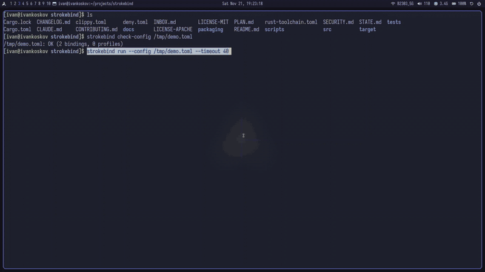

# strokebind

Mouse-stroke gestures for **any** Linux Wayland compositor (and X11). Hold a mouse button, draw a stroke, and
strokebind runs the action you bound to it: a key combo or a command. Plain clicks, including right-click menus, keep working.

<!-- demo-gif -->


- **Every compositor, and X11.** It reads the mouse through evdev and re-emits it through uinput, so it needs no compositor API.
- **Clicks still work.** A press that does not turn into a stroke is replayed as an ordinary click. Use a side or middle button as the trigger if you prefer.
- **No `ydotool`/`xdotool`, no root daemon.** Key actions go through its own virtual keyboard; a udev rule gives your seat user access instead of running anything as root.
- **Safe by design.** An escape chord, `--timeout`, and release of the grab on Ctrl-C, SIGTERM or a crash.
- **Easy to set up.** `record` shows the stroke you just drew, a TOML config is checked by `check-config` and reloads when saved, with per-device and per-app profiles.

## Install
Debian/Ubuntu: download the `.deb` from the GitHub release and install it (the package reloads the udev rule):

```sh
sudo apt install ./strokebind_*.deb
```

From source (Rust, see `rust-version` in `Cargo.toml`): a per-user install that never uses root and prints the one
root step (the udev rule) for you to run:

```sh
cargo build --release
./packaging/install.sh
```

Then log out and in once so the udev rule applies to your session.

## Quick start
```sh
strokebind list-devices                       # find your mouse
strokebind record                             # draw strokes; prints e.g. `L-U` after each release (no grab)
strokebind check-config ~/.config/strokebind/config.toml
strokebind run --config ~/.config/strokebind/config.toml --timeout 30   # try it with a 30 s safety net
systemctl --user enable --now strokebind.service                        # run it at login
```
`record` never grabs the mouse. `run` does, so keep `--timeout` on while trying a new config.

## Configuration
Strokes are `U D L R UL UR DL DR` joined by `-` (`L-U` = left, then up). The file lives at
`~/.config/strokebind/config.toml`; `install.sh` installs this starter:

```toml
trigger = "right"

[[binding]]
stroke = "L"
action = { key = "alt+left" }

[[binding]]
stroke = "R"
action = { key = "alt+right" }
```

More: commands, per-app bindings, per-device profiles and notifications.

```toml
trigger = "right"
min_stroke_px = 40          # shorter movements are clicks or wiggles
escape = "left+right+middle"
feedback = "notify"         # show each recognized stroke via notify-send

[[binding]]
stroke = "DR"
action = { run = ["notify-send", "hello"] }   # argv, no shell

[[binding]]
stroke = "L"
app = "firefox"             # WM_CLASS or app_id, case-insensitive
action = { key = "ctrl+shift+tab" }

[[profile]]
app = "kitty"

[[profile.binding]]
stroke = "R"
action = { key = "ctrl+shift+t" }

[[profile]]
device = "trackball"        # part of the device name
trigger = "middle"
```

Edits to bindings are picked up while `run` is running (a broken edit is reported and ignored); changing the trigger,
`min_stroke_px` or `escape` needs a restart. By default the pointer keeps moving while you draw; `freeze_pointer = true`
holds it still, and a release within `click_slop_px` (default 6) of the press counts as a click.

## Support matrix
Strokes and clicks work on every desktop, because strokebind reads the mouse through evdev. Per-app bindings
(`app = "..."`) need to know the focused window, which depends on the desktop:

| Desktop | Per-app bindings | How the focused app is read | Verified on a real session |
|---|---|---|---|
| X11 (any window manager) | yes | EWMH `_NET_ACTIVE_WINDOW` + `WM_CLASS` | yes (bspwm) |
| Sway | yes | i3 IPC `get_tree` over `SWAYSOCK` | yes |
| Hyprland | yes | `j/activewindow` over the socket named by `HYPRLAND_INSTANCE_SIGNATURE` | yes |
| KDE Plasma (Wayland) | global bindings only | not available in 0.1 | yes |
| GNOME (Wayland) | global bindings only | not available in 0.1 | yes |

"Verified" means `record` and `run` were checked by hand on that desktop: clicks, strokes, run and key-combo actions, and
(where supported) per-app bindings.

## Failsafes
`strokebind run` grabs your mouse exclusively, so there are several ways out that never need the mouse to work:
- **Escape chord:** hold all of its buttons at once to exit. The default is `left+right+middle`. Set it in the
  config with `escape = "side+extra"` (at least two distinct buttons from left, right, middle, side and extra).
  Only the mouse is read; strokebind never opens your keyboard.
  `run` refuses to start if the mouse lacks a chord button, so the escape always works.
- **`--timeout N`:** exit by itself after N seconds (N >= 1). Use this when trying a new config.
- **Ctrl-C / SIGTERM, or a crash:** the process exits and the kernel releases the grab.

## Comparison
| Tool | Works on | Notes |
|---|---|---|
| **strokebind** | every Wayland compositor and X11 | device-level; per-app bindings on X11, Sway, Hyprland |
| Easystroke | X11 only | discontinued |
| wstroke | wlroots compositors only | |
| Input Actions | KDE Plasma only | |
| mouse-actions | X11, limited on Wayland | alpha |

Based on a survey of these projects in November 2026. strokebind does not remap keys (see kanata, xremap) or handle
touchpad gestures (see libinput-gestures).

## FAQ
**Does a normal right-click still work?** Yes. A press that does not become a stroke is replayed as a click, so context menus open as usual.

**Why does it need access to `/dev/uinput`?** It re-emits your mouse through a virtual device and types key combos through a virtual keyboard. The udev rule grants this to the user at your seat; the daemon never runs as root.

**What if the mouse gets stuck?** Hold the escape chord (default left+right+middle), stop the service with `systemctl --user stop strokebind`, or press Ctrl-C. The kernel releases the grab when the process exits.

**Why are per-app bindings missing on KDE and GNOME?** strokebind has no focused-window adapter for them yet. Global bindings work there; per-app support is a 0.1 limitation.

**Can I keep my keyboard shortcuts?** Key actions use a virtual keyboard, and strokebind never reads your real keyboard.

## License
Dual-licensed under MIT or Apache-2.0, at your option.
